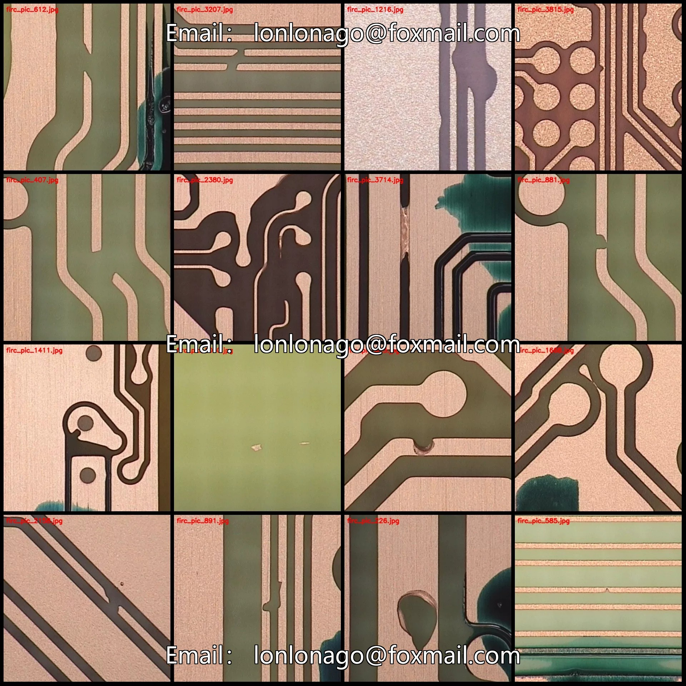
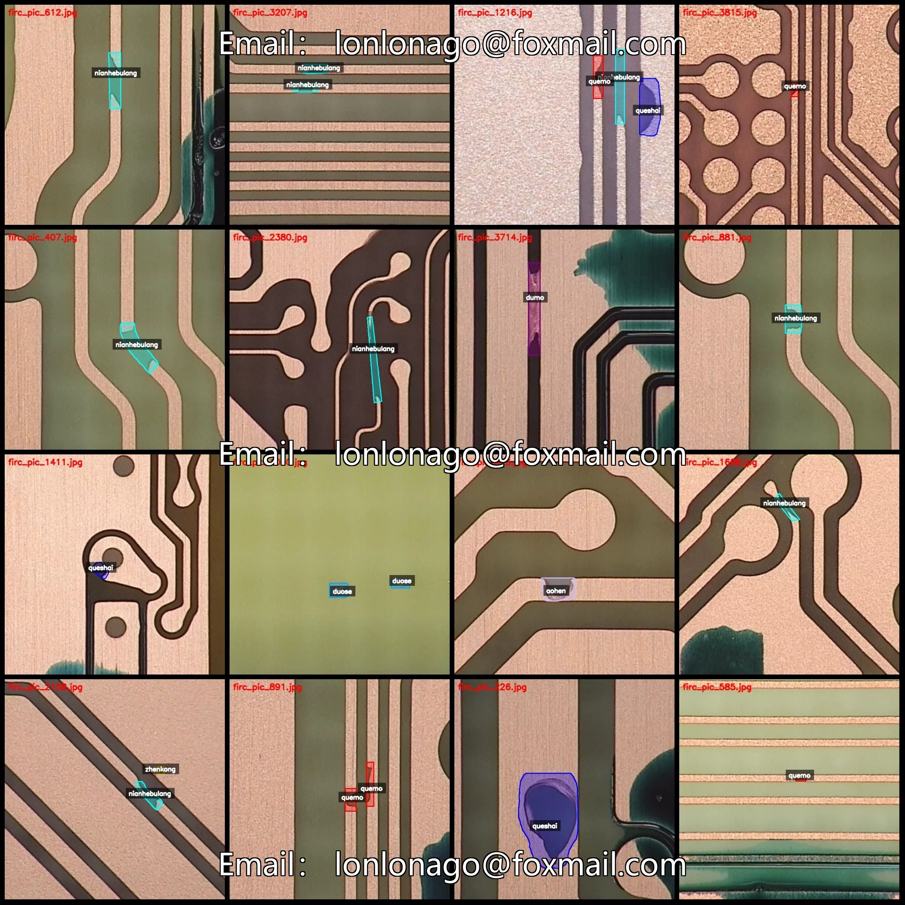
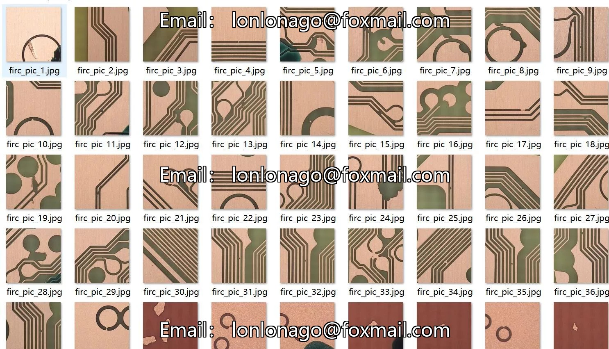
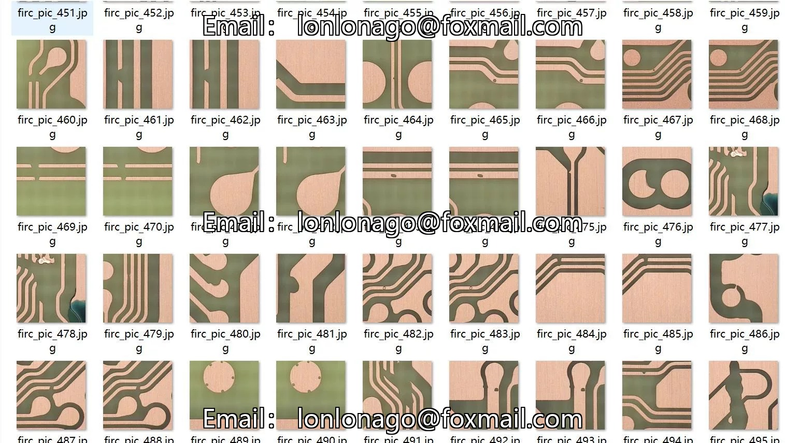
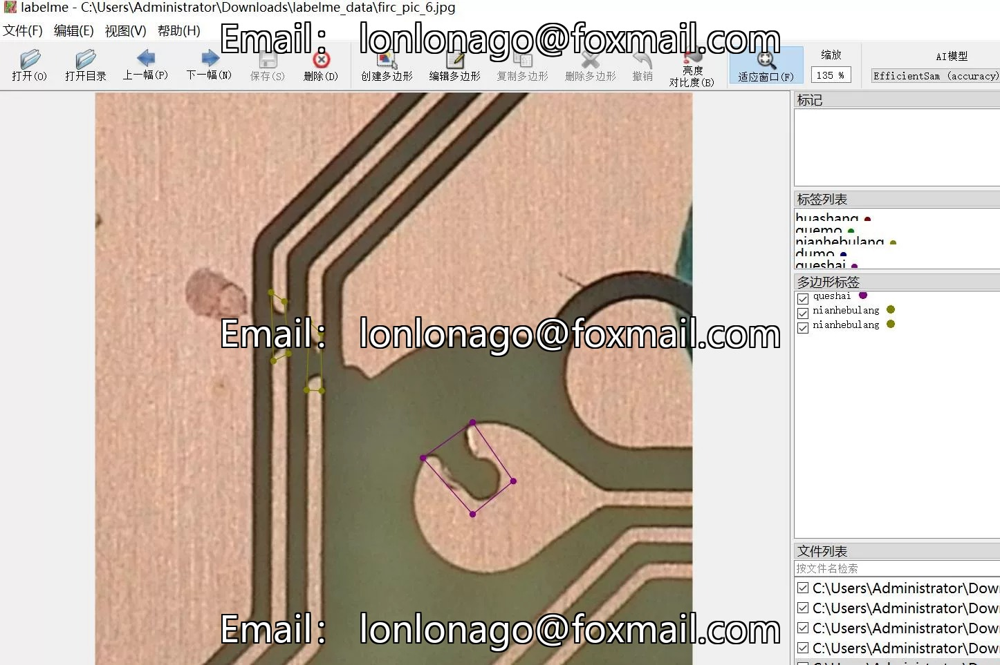
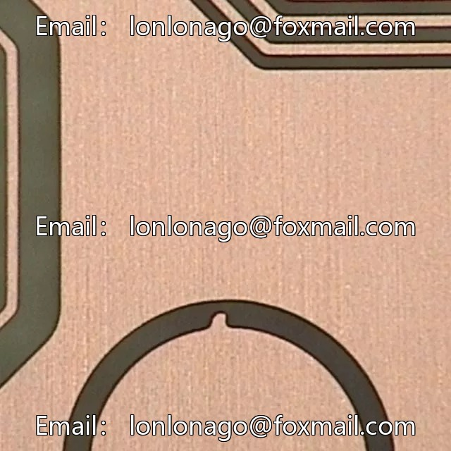
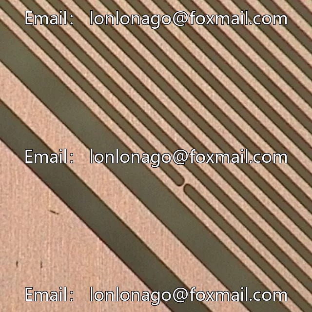
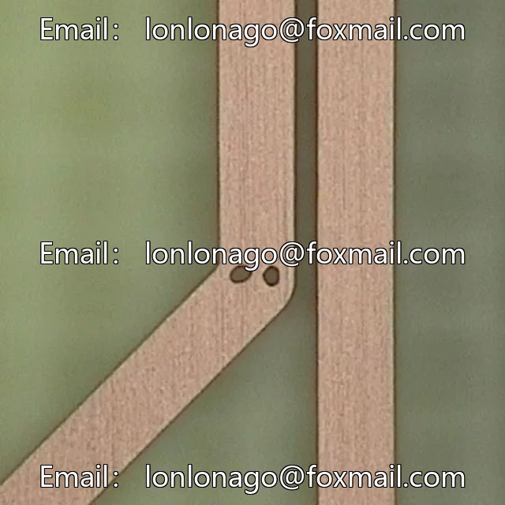

# Industrial Quality Inspection Board Tracing Diagnosis Data Set for PCB Defect Identification and Segmentation Labelme

## Body

Industrial Quality Inspection Board Tracing Diagnosis and Crack Identification Segmentation Data Set - LabelMe format - 4117 images in 9 categories
Tips: Due to the dataset's replicability, please confirm compliance with requirements before purchasing.
Dataset format: LabelMe format (excluding mask files, only including jpg images and corresponding json files)
Number of images (number of jpg files): 4117
Number of annotations (number of json files): 4117
Number of annotation categories: 9

Annotation Category Names: ["Aohen", "Dumo", "Duose", "Huashang", "Nianhebulang", "Quemou", "Queshai", "Yiwu", "Zhenkong"]
Corresponding Chinese Category Names: ["Affectation of Hole", "Blocked Ink", "Multicolor", "Scratch", "Adhesion Defect", "Missing Ink", "Missing Color", "Foreign Object", "Pinhole"]
Number of Boxes and Image Count for Each Category
Aohen Boxes = 191, Image Count = 161
Dumo Boxes = 849, Image Count = 633
Duose Boxes = 603, Image Count = 520

Huashang box count = 438, occupying image count = 388
Nianhebulang frame count = 1436, occupying image count = 1033
Quemomo box count = 930, occupying image count = 859
Questimate box count = 872, occupy image count = 638
Yiwu box number = 417, occupying picture count = 335
Zhenkong box count = 353, occupying image count = 282
Total frame count: 6089
Using labeling tool: labelme=5.5.0
Image resolution: 640x640
Annotation rules: Draw polygons around the categories.

Important Notice: The dataset can be opened and edited using LabelMe. For JSON datasets, you need to convert them into mask or Yolo formats for semantic segmentation or instance segmentation.
Special : This dataset does not guarantee the accuracy of the trained models or weight files.

## Images

## Payment

Here is a pay link on Stripe ( https://buy.stripe.com/3cs8yP7sY87d0vu9AB ). Please contact me lonlonago@foxmail.com after funding $89, and I will send you a complete data files , thank you!

